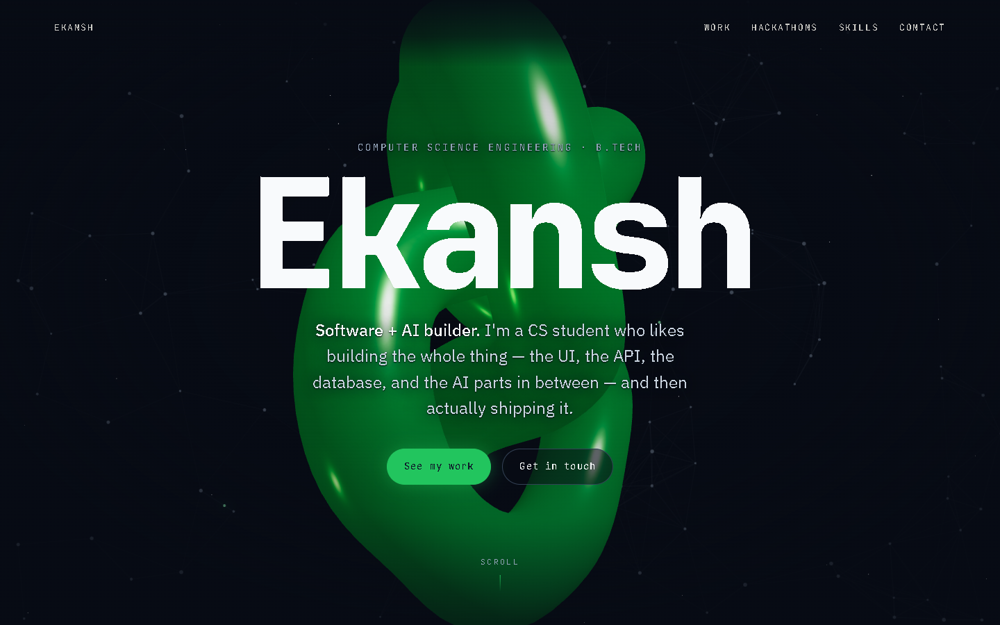
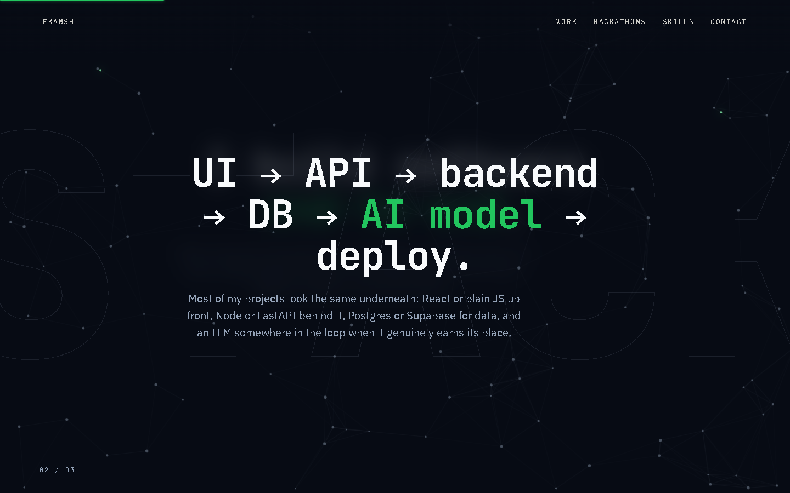
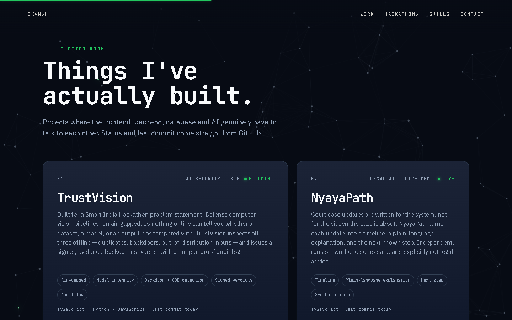
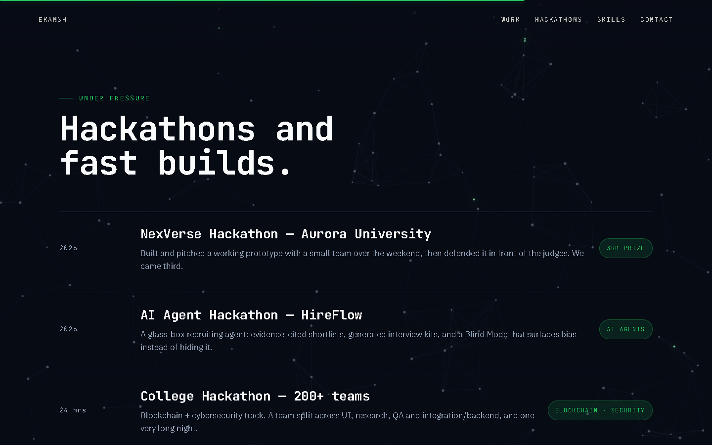
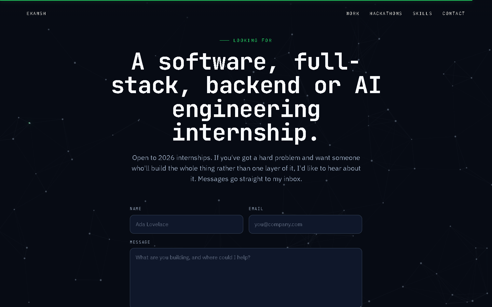
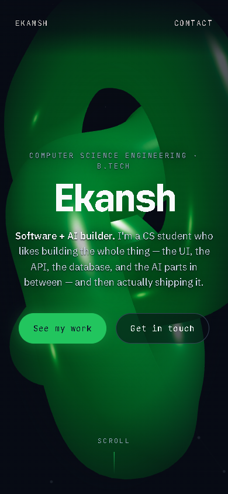
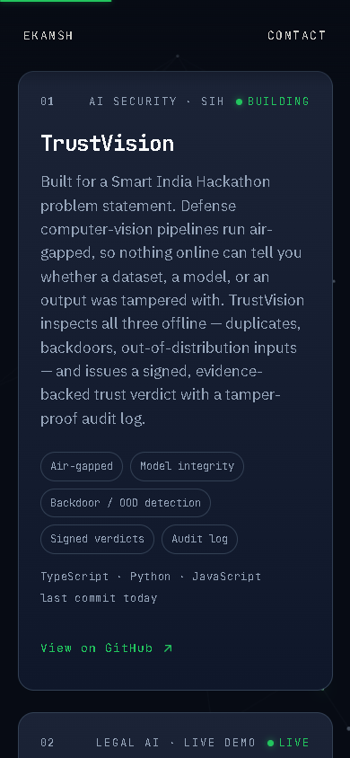
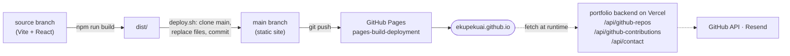

<p align="center"><a href="https://ekupekuai.github.io"></a></p>

<p align="center">
  <a href="https://ekupekuai.github.io"></a>
  <a href="https://github.com/ekupekuAI/ekupekuAI.github.io/actions/workflows/pages/pages-build-deployment"></a>
  
  
  
  
</p>

<p align="center">
  <a href="https://skillicons.dev"></a>
</p>

<p align="center">
  <b>Scroll-driven storytelling</b> with a 3D hero, pinned depth-of-field sections,<br>
  an interactive neural-network background, and project status pulled live from GitHub.<br><br>
  <a href="https://ekupekuai.github.io"><b>ekupekuai.github.io →</b></a>
</p>

---

## The pitch

I'm a CS student who builds the whole thing: the UI, the API, the database, and the AI parts in
between. This site is the front door to that work. It's a single page that plays as you scroll.
The title sinks into a Three.js knot, three pinned slides swap with a depth-of-field blur, and the
project cards show each repo's status and last commit, read from GitHub on every visit.

## What's on the page

| Section | What it does |
|---|---|
| **Hero** | Kinetic letter-by-letter title over a distorting Three.js torus knot. Scrolling tilts and sinks the knot while the type recedes and blurs. |
| **Live strip** | Public repo count, contributions this year, last commit, live demos and hackathon builds. All fetched or counted, none typed in. |
| **How I work** | A pinned section of three slides (BUILD / STACK / SOLVE) that swap with a blur-and-scale depth-of-field transition. |
| **Selected work** | Eight project cards with a gentle 3D tilt. Status (LIVE / BUILDING / ACTIVE / STABLE), languages and last commit come from the repo. A GitHub contribution graph sits underneath. |
| **Hackathons** | NexVerse (3rd prize), the AI Agent Hackathon (HireFlow), a 24-hour college hackathon, and SIH (TrustVision). |
| **Toolkit** | Two scroll-driven marquee rows, plus an honest legend: weekly use, shipped with, still learning, working on now. |
| **Contact** | A form that posts to the mail backend (with a honeypot field), plus LinkedIn, GitHub, Instagram and X links. |

The canvas **neural-network background** runs behind all of it. Nodes drift, synapses link
neighbours, and signals travel between them. The cursor excites nearby neurons and a click fires
a burst.

## Screenshots

<p align="center"></p>

<table>
  <tr>
    <td width="50%"></td>
    <td width="50%"></td>
  </tr>
  <tr>
    <td width="50%"></td>
    <td width="50%"></td>
  </tr>
</table>

<p align="center">
  
  &nbsp;&nbsp;
  
</p>

<sub>Captured from the live site at 1440×900 and 390×844.</sub>

## Stack

React 19 · Vite 8 · [Motion](https://motion.dev) (`motion/react`) for animation ·
[Lenis](https://lenis.darkroom.engineering) smooth scroll · Three.js via `@react-three/fiber` +
`@react-three/drei` for the hero object · Canvas 2D for the neural network.

Three.js is split into its own lazily loaded chunk, so the first paint doesn't wait for it.

## How it's built and deployed

This repo has two branches. GitHub Pages serves `main` directly. There's no Actions build step of
its own; Pages publishes whatever is committed there.

| branch   | contents                                   |
|----------|--------------------------------------------|
| `source` | this Vite project. **Edit here.**          |
| `main`   | built static output served by GitHub Pages |



### Run locally

```bash
npm install
npm run dev
```

Production build and local preview:

```bash
npm run build
npm run preview
```

### Publish

```bash
bash deploy.sh
```

`deploy.sh` builds the site, clones `main` into a temp folder, replaces its contents with
`dist/`, adds `.nojekyll`, commits, and pushes. Pages usually updates within a minute.

## Live data + contact form

GitHub Pages is static, so no secrets live here. A small Next.js backend (the
[`ekupekuAI/portfolio`](https://github.com/ekupekuAI/portfolio) repo, deployed at
`https://portfolio-a5y6.vercel.app`) holds the Resend mail key and the GitHub token. It exposes
three CORS-enabled routes:

| route | used for |
|---|---|
| `POST /api/contact` | the contact form (Resend → inbox) |
| `GET /api/github-repos` | project status badges, "last commit", languages, live strip |
| `GET /api/github-contributions` | the contribution graph |

The backend address is `VITE_API_BASE` (see [`.env.example`](.env.example)). For a local
backend, put it in `.env.development.local`, not `.env.local`, because Vite bakes `.env.local`
into production builds too. Project status is derived from the repo's last push, never typed by
hand. If the backend is unreachable, the live widgets simply don't render and the rest of the
page works as normal.

**Add a project:** add an entry to `projects` in `src/data.js` with `repo` set to the GitHub
repo name. Status, last commit and languages follow automatically.<br>
**Show the resume button:** drop `public/resume.pdf` in and set `profile.resume: "./resume.pdf"`.
The print-first source is `resume/resume.html`.

<details>
<summary><b>Project structure</b></summary>

```
src/
  data.js                 all copy: profile, story, projects, hackathons, skills (edit content here)
  App.jsx                 page composition + nav + progress bar
  styles.css              design tokens + all styling
  main.jsx                entry; MotionConfig reducedMotion="user"
  lib/useLenis.js         smooth scroll + hash-link routing
  lib/api.js              backend address, GitHub hooks, status derivation, sendContact
  components/
    Hero.jsx / Hero3D.jsx kinetic title + Three.js knot driven by scroll
    Story.jsx             pinned section, blur/depth-of-field slide swap
    Projects.jsx          project grid with 3D tilt cards, live status, contribution graph
    Sections.jsx          live strip, hackathons, skills marquee, contact form + links
    NeuralBg.jsx          interactive neural-network canvas background
    Interactive.jsx       CursorGlow, Magnetic, TiltCard
public/                   favicon.svg, og.png (copied into the build as-is)
resume/resume.html        print-first resume source
deploy.sh                 build + publish to the main branch
docs/readme/              README banner and screenshots (not part of the site build)
```

</details>

## Accessibility

- Honours `prefers-reduced-motion`. Pinned scroll, 3D drift, the marquee, cursor effects and the
  neural-network animation are turned off, and the story slides stack as plain sections.
- Keyboard-focusable, with visible focus rings and tap targets of 44px or more.
- No horizontal scroll at phone widths (checked at 375px and 390px).

## Future development

The site works as-is. These are improvements, not bugs:

- **Lighter mobile / low-power path.** The Three.js hero chunk is about 917 KB (244 KB gzipped)
  and loads on every device, phones included.
- **Pause the 3D canvas off-screen.** It keeps rendering after the hero has scrolled away.
- **Stable neural background on phones.** Every `resize` re-randomizes the nodes, and on mobile
  the address bar showing or hiding fires a resize.
- **Cheaper network drawing.** Synapses are stroked one by one (up to about 11k pairs per frame);
  batching them into a few paths would cut draw calls.
- **Resume download.** `public/resume.pdf` isn't published yet, so the button stays hidden.
- **AI Dropout Prediction** links to the GitHub profile until it has a public repo.
- three.js logs a `THREE.Clock` deprecation warning (from the 3D libraries, not site code). It
  will clear with a future `@react-three/fiber` update.
